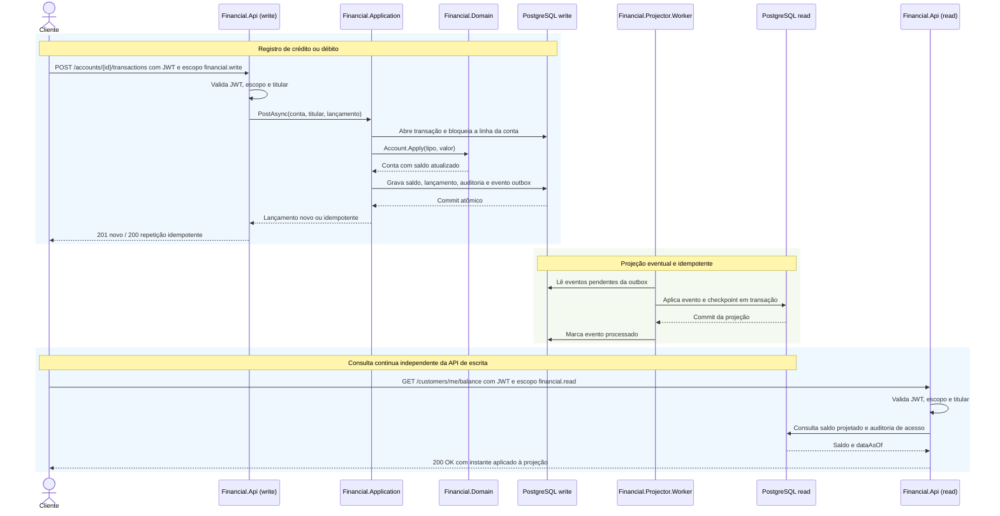

# Financial

API demonstrativa em C#/.NET para registrar créditos e débitos e consultar saldo atual ou histórico. O exemplo prioriza lançamento contábil imutável, idempotência e proteção contra saldo negativo.

## Stack

- C# e .NET 10 / ASP.NET Core Minimal APIs
- Swagger e OpenAPI com Swashbuckle
- Autenticação JWT Bearer
- Persistência transacional em PostgreSQL com Npgsql; JSON permanece disponível somente para testes isolados
- Outbox transacional e projeção de leitura idempotente
- Health checks e telemetria OpenTelemetry/OTLP
- Escopos JWT, rate limiting e limites de requisição
- Testes automatizados com xUnit e `Microsoft.AspNetCore.Mvc.Testing`
- Integração contínua com GitHub Actions

## Requisitos

- .NET SDK 10.0.402 (ou patch posterior da linha 10.0)
- PowerShell no Windows (`powershell.exe`) ou PowerShell 7 no Linux/macOS (`pwsh`), para executar os scripts locais (`.ps1`)
- Docker Desktop ou Docker Engine com Compose, para os bancos PostgreSQL locais e testes de integração
- Windows, Linux ou macOS

## Executar localmente

```bash
dotnet restore
```

A solução executa uma API de escrita, uma API de leitura e um projetor de eventos. Os dois bancos PostgreSQL locais são independentes. Suba-os antes dos serviços:

```powershell
docker compose up -d financial-write-db financial-read-db
```

O schema inicial é aplicado no início da API; as migrations ficam em `src/Financial.Infrastructure/Migrations`. O adapter JSON permanece disponível somente para testes e isolamento local. No PowerShell, inicie a API pelo script, que configura valores JWT temporários e a conexão local apenas para desenvolvimento:

No primeiro terminal:

```powershell
powershell.exe -ExecutionPolicy Bypass -File .\scripts\Start-FinancialApi.ps1
```

No Linux ou macOS, use `pwsh -File ./scripts/Start-FinancialApi.ps1`. No Windows, a opção `-ExecutionPolicy Bypass` vale somente para esse processo e não altera a política permanente do sistema. A API de escrita usa `http://localhost:5080`.

Em um segundo terminal, gere um token curto. O script define os valores JWT locais usados pela API. No Windows:

```powershell
$token = powershell.exe -ExecutionPolicy Bypass -File .\scripts\New-LocalJwt.ps1 -Subject "cliente-123"
```

No Linux ou macOS, use `$token = pwsh -File ./scripts/New-LocalJwt.ps1 -Subject "cliente-123"`. O token vale por cinco minutos e inclui os escopos locais de leitura e escrita.

Em terminais separados, inicie também a API de leitura e o projetor:

```powershell
powershell.exe -ExecutionPolicy Bypass -File .\scripts\Start-FinancialReadApi.ps1
powershell.exe -ExecutionPolicy Bypass -File .\scripts\Start-FinancialProjector.ps1
```

A API de leitura escuta em `http://localhost:5081`. Cada API tem Swagger em `/swagger`; a de escrita recebe `POST`, e a de leitura atende `GET`. A projeção é eventualmente consistente. As respostas de saldo incluem `dataAsOf`, o instante mais recente aplicado; aguarde o projetor após registrar a primeira conta ou lançamento. O token local de desenvolvimento é previsível e não deve ser reutilizado fora desse ambiente.

Criar conta:

```powershell
curl.exe -X POST http://localhost:5080/accounts -H "Authorization: Bearer $token"
```

O `201 Created` retorna a URL da conta, disponível somente para o titular:

```powershell
curl.exe -H "Authorization: Bearer $token" http://localhost:5081/accounts/{accountId}
```

Registrar crédito ou débito (valores inteiros em centavos):

```powershell
curl.exe -X POST http://localhost:5080/accounts/{accountId}/transactions -H "Authorization: Bearer $token" -H "Content-Type: application/json" -d '{"type":"credit","amountInCents":12500,"idempotencyKey":"pagamento-abc-001","description":"depósito"}'
```

Substitua `{accountId}` pelo identificador retornado na criação da conta.

O `201 Created` retorna a URL do lançamento criado. Ela pode ser consultada pelo mesmo titular:

```powershell
curl.exe -H "Authorization: Bearer $token" http://localhost:5081/accounts/{accountId}/transactions/{transactionId}
```

Consultar saldo atual ou posição até uma data/hora no padrão brasileiro:

```powershell
curl.exe -H "Authorization: Bearer $token" http://localhost:5081/accounts/{accountId}/balance
curl.exe -G --data-urlencode "at=28/10/2026 09:00:00 -03:00" -H "Authorization: Bearer $token" http://localhost:5081/accounts/{accountId}/balance
curl.exe -H "Authorization: Bearer $token" http://localhost:5081/customers/me/balance
curl.exe -G --data-urlencode "at=28/10/2026 09:00:00 -03:00" -H "Authorization: Bearer $token" http://localhost:5081/customers/me/balance
```

O parâmetro `at` usa `dd/MM/yyyy HH:mm:ss zzz`, com fuso explícito. O exemplo representa o horário de Brasília (`-03:00`).

A conta é criada com o `sub` do token; somente tokens com o mesmo `sub` podem consultar ou movimentar essa conta. As APIs validam assinatura, emissor, audiência, validade e escopo (`financial.read` ou `financial.write`). Elas não emitem tokens nem autenticam credenciais de usuário. Fora de `Development`, configure `Jwt:Authority`, `Jwt:Issuer` e `Jwt:Audience` para um provedor confiável; a chave simétrica local é recusada. A conexão PostgreSQL de produção deve usar TLS com validação do certificado (`SslMode=VerifyFull`) e segredos injetados por um gerenciador seguro.

Os comandos HTTP acima usam `curl.exe` no Windows. Em Linux ou macOS, use `curl` no lugar; para executar os scripts `.ps1`, instale PowerShell 7 (`pwsh`).

## Testes

Os testes unitários usam JSON temporário. Os testes de concorrência e projeção precisam de PostgreSQL. Suba os dois bancos primeiro:

```bash
docker compose up -d financial-write-db financial-read-db
```

No PowerShell:

```powershell
$env:FinancialTests__PostgresConnectionString = "Host=localhost;Port=5432;Database=financial;Username=financial;Password=financial-local-only"
dotnet test
```

No Linux/macOS, exporte a mesma variável antes de executar `dotnet test`. Localmente, a suíte usa o banco de escrita também para o schema de leitura quando `FinancialTests__ReadPostgresConnectionString` não está definido. Para exercitar bancos independentes, configure essa variável com a conexão administrativa do PostgreSQL de leitura. O CI provisiona dois serviços PostgreSQL efêmeros separados e executa a suíte contra ambos.

Os testes JSON cobrem regras de domínio, autenticação e contratos HTTP; os testes PostgreSQL exercitam concorrência entre conexões, idempotência, atomicidade da outbox e reprocessamento da projeção. Um teste HTTP publica uma movimentação, encerra o host da API de escrita e confirma que a API de leitura continua consultando o saldo consolidado projetado, mesmo com a conexão de escrita indisponível. Os testes de integração criam schemas isolados e removem esses schemas ao final.

O gerador de carga em `tools/Financial.LoadTest` executa escritas sintéticas distribuídas por uma lista de contas, com concorrência, duração e taxa programada configuráveis. Ele exige a flag `--allow-write-load` e grava créditos de um centavo que permanecem no banco informado; use somente uma API e contas de ensaio. Os resultados sustentados documentados, incluindo latência e reconciliação da projeção, estão em [`docs/runbook.md`](docs/runbook.md).

Para ensaios de leitura, `scripts/Seed-FinancialReadLoadTest.ps1` prepara fixtures sintéticos persistentes em um banco PostgreSQL dedicado, separado da base usada pela API ativa. A base contém 1.000 contas em quatro titulares e não representa o ledger de escrita; consulte o procedimento e as limitações em [`docs/runbook.md`](docs/runbook.md).

## Organização do código

```text
src/
  Financial.Domain/         agregado Account, Money e FinancialEntry
  Financial.Application/    casos de uso, contratos e porta do repositório
  Financial.Infrastructure/ adapters PostgreSQL e JSON de teste, migrations e projetor
  Financial.DatabaseMigrator/ executável para aplicar migrations como etapa controlada
  Financial.Api/            modos de escrita/leitura, JWT, Swagger e health checks
  Financial.Projector.Worker/ consumidor da outbox e projeção de leitura
tests/
  Financial.Api.Tests/      testes automatizados dos casos de uso
tools/
  Financial.LoadTest/       gerador controlado de carga sintética da API
```

O domínio não depende de HTTP ou armazenamento. A aplicação depende do domínio e define portas de escrita e leitura; a infraestrutura as implementa, e a API conecta as dependências. As premissas da revisão ficam em [`docs/requirements-and-decisions.md`](docs/requirements-and-decisions.md), as decisões em [`docs/architecture.md`](docs/architecture.md) e os procedimentos em [`docs/runbook.md`](docs/runbook.md).

## Fluxo principal



## Guia rápido para avaliação

| Tema | Onde conferir |
| --- | --- |
| Regras de conta, valores e lançamentos | `src/Financial.Domain/` |
| Crédito, débito, idempotência e saldos atuais/históricos | `src/Financial.Application/FinancialApplicationService.cs` |
| Transação PostgreSQL, bloqueio da conta e outbox | `src/Financial.Infrastructure/PostgresFinancialRepository.cs` |
| Projeção eventual e consultas independentes | `src/Financial.Infrastructure/PostgresOutboxProjector.cs`, `src/Financial.Infrastructure/PostgresFinancialReadRepository.cs` |
| JWT, escopos, endpoints, Swagger e health checks | `src/Financial.Api/` |
| Testes de regras e contrato HTTP | `tests/Financial.Api.Tests/` |
| Premissas e metas operacionais | [`docs/requirements-and-decisions.md`](docs/requirements-and-decisions.md) |
| Operação, recuperação e troubleshooting | [`docs/runbook.md`](docs/runbook.md) |
| Decisões e limites | [`docs/architecture.md`](docs/architecture.md) |

## Decisões de arquitetura

- **Ledger append-only:** cada operação aprovada gera uma entrada de valor assinado e nunca se altera/exclui; correções futuras devem ser novos lançamentos compensatórios e auditáveis.
- **Centavos inteiros:** evita arredondamento binário de ponto flutuante. `long` tem limite finito, validado por aritmética checked.
- **Moeda assumida:** os valores em centavos representam reais (BRL). O modelo não converte moedas.
- **Persistência transacional:** PostgreSQL registra conta, saldo, lançamento, auditoria e outbox. A linha da conta fica bloqueada durante a validação do débito; constraints no banco protegem a idempotência entre instâncias.
- **Leitura separada:** a API de consulta usa outro banco e não precisa conectar ao serviço nem ao banco de escrita. `dataAsOf` mostra a atualidade da projeção, cuja consistência é eventual.
- **Outbox:** o evento é inserido na mesma transação financeira. O projetor aplica-o idempotentemente; se parar, a leitura mantém a última projeção e o backlog pode ser recuperado após reiniciar.
- **JSON:** permanece apenas como adapter de apoio a testes locais; não é o armazenamento padrão da aplicação.
- **Idempotência:** chave única por conta; repetição com os mesmos campos devolve o lançamento original, e conteúdo diferente na mesma chave retorna 409.
- **DDD e Clean Architecture proporcionais:** `Account` protege regras do agregado; `Money` encapsula centavos; `FinancialEntry` é imutável. A aplicação define portas, e os adapters PostgreSQL ficam na infraestrutura. A API opera nos modos `write` e `read`; `combined` é restrito a testes e desenvolvimento.

## Limites e evolução para produção

Esta revisão substitui o ledger JSON por PostgreSQL, inclui migrations versionadas e proteção concorrente no banco. O `docker-compose.yml` é um ambiente local com dois bancos individuais; não provisiona replicação, failover, backups externos ou alta disponibilidade. Essas garantias exigem uma plataforma gerenciada, topologia de implantação e exercícios de recuperação. As metas de SLA, carga, latência, RTO e RPO em `requirements-and-decisions.md` são premissas de avaliação, ainda não medidas nem aprovadas pelo negócio.

O saldo consolidado aqui significa saldo contábil resultante de lançamentos ordenados por `OccurredAt` (UTC). Requisitos de data-valor, lançamentos retroativos, ordenação total, estornos, limites/regulação e saldo disponível versus contábil precisam ser definidos pelo produto. Para histórico com alta taxa de consulta, snapshots devem ser reconstruíveis e conciliados com o ledger.

As APIs exigem escopos distintos, limitam taxa e tamanho de payload e recusam chave JWT simétrica fora de `Development`. Movimentações e consultas geram auditoria estruturada; logs e métricas não registram valores nem identificadores de clientes. Traces, métricas OTLP e health checks podem ser enviados ao backend configurado pelo ambiente. TLS e criptografia em repouso dependem da plataforma de banco e da terminação HTTPS; o ambiente local não simula essas proteções. Carga, failover real e restauração ainda precisam ser exercitados com as metas definidas.

## Contrato resumido

| Operação | Resultado |
| --- | --- |
| `POST /accounts` | Cria conta a partir de referência opaca do titular |
| `GET /accounts/{id}` | Consulta os dados da conta do titular |
| `POST /accounts/{id}/transactions` | Registra `credit` ou `debit`, em centavos, com `idempotencyKey` |
| `GET /accounts/{id}/transactions/{transactionId}` | Consulta um lançamento da conta |
| `GET /accounts/{id}/balance` | Saldo atual |
| `GET /accounts/{id}/balance?at={data/hora}` | Saldo até o instante informado (`dd/MM/yyyy HH:mm:ss zzz`) |
| `GET /customers/me/balance` | Saldo consolidado das contas do titular autenticado, atual ou histórico |

Erros de validação retornam `400`, recurso ausente `404`, conflito/idempotência `409` e saldo insuficiente/overflow `422`. Erros da API usam `ProblemDetails` (`application/problem+json`); falhas inesperadas são tratadas pelo middleware padrão de exceções.

## Publicação

O código está publicado em [github.com/ALRSO85/Financial](https://github.com/ALRSO85/Financial), na branch `main`. A integração contínua executa restore, build e testes a cada push e pull request.
