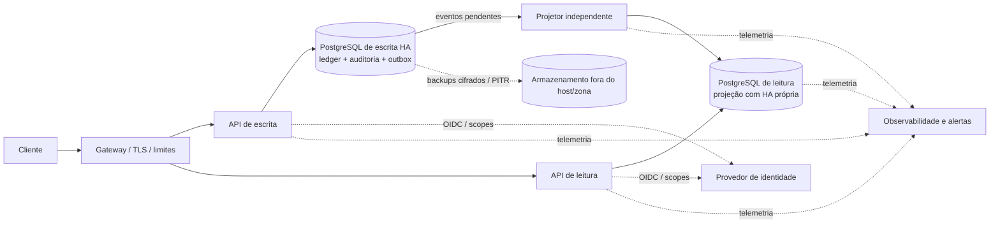

# Proposta de arquitetura

Depois do retorno da avaliação, a revisão separou a escrita da consulta para que o consolidado continue respondendo quando o processo transacional parar. O sandbox demonstra essa separação entre processos, mas os bancos ainda estão no mesmo servidor; portanto, não comprova alta disponibilidade física.

## O que a devolutiva pede

O requisito de disponibilidade mais explícito é manter a consulta consolidada funcionando quando o serviço de transações parar. A solução agora executa APIs e bancos de leitura e escrita separados, e há um teste que interrompe o processo de escrita e verifica que a leitura continua respondendo com a projeção existente.

A devolutiva também pede clareza sobre metas operacionais, consistência, domínio financeiro, operação, segurança e recuperação. O desafio original não definiu SLA, SLO, volume, latência, RTO ou RPO. Os números registrados nos documentos são hipóteses de trabalho para orientar testes; não são requisitos fornecidos nem compromissos aprovados pela empresa.

## Premissas do domínio

Para tornar o exercício concreto, a revisão assume contas em BRL e valores inteiros em centavos. O saldo é contábil; reservas, saldo disponível, crédito, liquidação externa e transferências estão fora do escopo. Lançamentos confirmados não são editados ou removidos: correções geram lançamentos compensatórios. A API atribui o instante do lançamento e não aceita retroatividade. Essas decisões precisam ser confirmadas pelo responsável de produto antes de serem tratadas como regras empresariais.

## Desenho proposto

As APIs podem compartilhar código, mas devem ser implantadas e operadas separadamente. O PostgreSQL de escrita é a fonte oficial do ledger. O banco de leitura guarda uma projeção que pode ser reconstruída. O diagrama representa o destino arquitetural, não o sandbox atual: hoje os bancos compartilham o mesmo host, sem standby, gateway de produção ou armazenamento externo.

## Decisões principais

| Escolha | Motivo e alternativa considerada | Estado |
| --- | --- | --- |
| PostgreSQL para o ledger | Transações, constraints e locks por conta coordenam gravações entre processos. O JSON é simples para um protótipo, mas não protege concorrência entre instâncias. | Em uso no sandbox. |
| Leitura separada e projeção eventual | A consulta não depende do processo nem da conexão de escrita e pode servir a última projeção, informando `dataAsOf`. A contrapartida é aceitar atraso e operar um projetor. | APIs e bancos separados no mesmo host. |
| Outbox transacional | O lançamento e o evento são gravados no mesmo commit. O projetor pode repetir mensagens sem duplicar a projeção. Um broker não foi escolhido porque acrescentaria operação sem eliminar a necessidade de idempotência. | Implementada; retenção e arquivamento da outbox ainda precisam de política. |
| PostgreSQL gerenciado com standby síncrona | Evita que a equipe do desafio opere quorum, promoção e fencing. A alternativa autogerenciada com Patroni/etcd dá mais controle, mas exige manter esses componentes e testar recuperação. | Recomendada na [ADR de alta disponibilidade](decisions/adr-0001-postgresql-high-availability.md); provedor não escolhido. |
| HA própria para o banco de leitura | Evita que uma única instância de leitura interrompa as consultas. A projeção pode ser refeita a partir da outbox. | Proposta; o sandbox usa uma instância no mesmo host. |
| OIDC e papéis PostgreSQL separados | Um provedor confiável valida identidade e escopos; credenciais distintas limitam o acesso do runtime e reservam DDL ao migrador. | O código suporta OIDC fora de `Development`; os papéis foram separados nos bancos de monitoramento do sandbox. |
| Backup cifrado fora do host | Uma cópia no mesmo servidor não protege contra perda do host. Dumps locais são úteis para ensaiar restore, mas não são recuperação de desastre. | Scripts aceitam `age` e `rclone`; chave e destino externos ainda não foram configurados. |

## Comportamento em falhas

| Falha | Resposta esperada |
| --- | --- |
| API ou banco de escrita indisponível | Não confirmar novas movimentações. A API de leitura pode servir a última projeção e indicar sua idade. |
| Banco de leitura ou projetor indisponível | A escrita continua registrando eventos na outbox. A leitura fica indisponível ou atrasada até a recuperação; não consulta o banco de escrita como fallback silencioso. |
| Evento repetido | O registro de eventos projetados evita duplicar saldo. O projetor pode retomar a confirmação da outbox depois de uma queda. |
| Perda do primário de escrita | A proposta usa failover com fencing do primário antigo. Escritas só voltam após validar o endpoint e a durabilidade; esse cenário não foi testado no sandbox. |
| Perda do host ou da zona | A recuperação exige infraestrutura em outro domínio de falha ou backup externo. O ambiente atual não cobre essa situação. |

## Metas para validação

Os valores abaixo são alvos iniciais para dimensionamento, não SLOs aprovados. A janela de medição, as exclusões de manutenção e os responsáveis por incidentes também precisam ser definidos.

| Indicador | Hipótese de trabalho | Evidência necessária |
| --- | --- | --- |
| Disponibilidade das APIs | 99,9% mensal para escrita e consulta | Medição contínua em infraestrutura redundante e testes de falha. |
| Latência | Escrita: p95 ≤ 300 ms e p99 ≤ 1 s. Leitura: p95 e p99 ≤ 500 ms. | Testes de carga com perfil acordado e telemetria por rota no ambiente de destino. |
| Carga | 100 operações/s sustentadas; pico de 500 operações/s por 5 minutos. | Carga de leitura e escrita, ledger representativo e observação durante incidentes. |
| Atualidade da projeção | Até 30 s em condição normal; degradada após 5 min. | Medir a idade dos eventos e alertar no limite aprovado. |
| RPO / RTO | RPO 0 para escrita confirmada; RTO de 30 min para escrita e 15 min para leitura. | Exercício cronometrado de failover ou restore, seguido de reconciliação. |

## O que já foi demonstrado

Os testes cobrem regras financeiras, idempotência, concorrência entre processos, replay da outbox e continuidade da leitura durante a parada do processo de escrita. Também há ensaios locais de carga, backup/restore e observabilidade. O hardening dos papéis PostgreSQL foi aplicado no sandbox.

Essas evidências estão registradas no [runbook](runbook.md). Elas não demonstram queda do PostgreSQL ou do host, failover multi-host, RPO/RTO de produção, recepção externa de alertas nem cópia de backup fora do servidor. O sandbox ainda tem uma exceção explícita que permite backups em claro enquanto `age` e o destino externo não são provisionados.

## Decisões que faltam

Produto e negócio precisam confirmar moeda, estornos, reservas, saldo disponível, retroatividade, atraso aceitável da consulta, volume e retenção. Plataforma precisa escolher provedor, região, zonas, orçamento e estratégia de failover. Segurança e operação precisam definir identidade, secret manager, rotação, custódia da chave de backup, destino externo, canal de alertas e retenção de telemetria.
