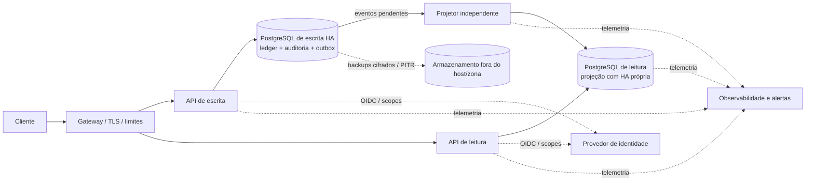

# Proposta arquitetural para avaliação

**Objetivo:** apresentar de forma organizada as decisões da revisão, o motivo de cada escolha, o comportamento esperado em falhas e o que a evidência atual permite afirmar. Este documento separa requisitos relatados pela avaliação, premissas adotadas para o exercício e uma arquitetura-alvo que depende de decisões e infraestrutura externas.

## 1. Síntese executiva

A proposta mantém a movimentação financeira em um ledger PostgreSQL transacional e separa a consulta consolidada em um modelo de leitura atualizado por eventos da outbox. A API de escrita confirma uma movimentação somente depois de persistir, no mesmo commit, o lançamento, o saldo, a auditoria e o evento que alimentará a projeção. A consulta pode continuar servindo a última projeção quando a API de escrita ou seu banco estiverem indisponíveis, informando a atualidade dos dados.

Essa separação reduz a dependência entre os fluxos, mas não basta para garantir disponibilidade de infraestrutura. A demonstração atual separa processos e bancos em containers no mesmo servidor. A arquitetura-alvo adiciona bancos com alta disponibilidade em domínios de falha independentes, deploys isolados, cópias de backup cifradas fora do host e exercícios de failover e restauração.

Os valores de disponibilidade, volume, latência, RTO e RPO registrados no projeto são metas provisórias de avaliação. Não foram fornecidos ou aprovados pela empresa e não devem ser apresentados como compromissos operacionais.

## 2. Como interpretar a devolutiva

| Tema da avaliação | Leitura para esta proposta |
| --- | --- |
| Consolidado deve continuar funcionando quando o serviço transacional cair | Requisito de disponibilidade relatado na devolutiva. A solução precisa separar o caminho de leitura do processo de escrita e explicitar a idade dos dados disponíveis. |
| SLA/SLO, volume, latência, RTO e RPO ausentes | Lacuna de definição. Os números deste exercício são hipóteses para orientar dimensionamento e ensaios, aguardando validação do negócio. |
| Testes de falha, carga, restore e consistência | Critérios de demonstração. A evidência atual cobre processos, concorrência, projeção, alguns ensaios de carga e restore; não cobre perda de host ou failover físico. |
| Segurança, operação e observabilidade | A devolutiva aponta atributos que precisam de desenho e evidência. Os controles locais existentes não equivalem a uma operação de produção. |
| JSON e processo único | Diagnóstico da versão inicial. Nesta revisão, PostgreSQL e processos separados já foram adotados no sandbox; a alta disponibilidade do banco permanece uma proposta. |

## 3. Premissas de domínio

As premissas abaixo tornam o desenho verificável, mas precisam ser confirmadas pelo responsável de produto antes de serem tratadas como regras empresariais:

- O escopo inicial usa BRL e valores inteiros em centavos. Não há conversão nem consolidação entre moedas.
- O saldo apresentado é contábil. Reservas, saldo disponível, limite de crédito, liquidação e pagamentos externos estão fora do escopo.
- Lançamentos confirmados são imutáveis. Correções são feitas por lançamentos compensatórios vinculados ao original.
- O sistema atribui o instante do lançamento; não aceita retroatividade nesta proposta.
- Débitos não deixam o saldo contábil negativo. Transferências entre contas não fazem parte do recorte.
- A identidade autenticada do titular é opaca e não deve ser normalizada ou exposta em telemetria.

As definições detalhadas estão em [`requirements-and-decisions.md`](requirements-and-decisions.md).

## 4. Arquitetura-alvo

As APIs podem compartilhar código e contratos, mas devem ser executadas como processos e implantações independentes. O banco de escrita é a fonte autoritativa do ledger. O banco de leitura contém uma projeção reconstruível. A topologia no diagrama é o estado desejado; o sandbox não dispõe de standby, zonas independentes, gateway de produção ou armazenamento externo.

## 5. Decisões arquiteturais e alternativas

| Decisão | Motivo | Alternativa considerada e custo | Situação |
| --- | --- | --- | --- |
| PostgreSQL transacional para o ledger | Commit ACID, unicidade no banco, locks por conta e coordenação entre instâncias. Evita regravar o arquivo inteiro e depender de mutex em memória. | JSON é simples para protótipo, mas não oferece transação concorrente ou coordenação entre processos. | Implementado no sandbox. |
| API e banco de leitura separados | Permitem servir a última projeção sem depender do processo nem da conexão de escrita. | Consultar sempre o banco de escrita oferece leitura mais atual, mas compartilha falhas e carga com movimentações. | Implementado em containers no mesmo host. |
| Transactional outbox e projetor idempotente | Ledger e evento são confirmados no mesmo commit; o consumidor pode repetir eventos sem duplicar saldo. | Publicar diretamente após o commit cria uma janela de perda; adicionar broker agora aumenta componentes e operação sem remover a necessidade de idempotência. | Implementado; outbox sem política de retenção/arquivamento aprovada. |
| PostgreSQL gerenciado com réplica síncrona para escrita | Reduz operação de promoção, fencing e backup pelo time do desafio, mantendo commits confirmados na standby elegível. | PostgreSQL autogerenciado com Patroni/etcd dá controle, mas exige operar quorum, fencing, upgrades, monitoramento e recuperação. | Proposta em [`ADR-0001`](decisions/adr-0001-postgresql-high-availability.md); provedor não escolhido. |
| Banco de leitura com HA própria e reconstrução pela outbox | Mantém consulta disponível e permite reconstruir o modelo após perda da réplica. | Um único banco de leitura é mais barato, mas representa ponto único de falha para consultas. | Proposta; o sandbox usa uma instância no mesmo host. |
| Identidade OIDC e autorização por escopos e titular | Evita emitir identidade de usuário dentro da API e limita cada operação ao escopo e titular do token. | Chave JWT simétrica estática simplifica o desenvolvimento, mas não é gestão de identidade ou segredo de produção. | Código aceita provedor externo fora de Development; sandbox usa JWT local. |
| Papéis PostgreSQL distintos para runtime e migration | Limita dano de credenciais da aplicação; apenas o migrador altera schema. | Runtime como owner facilita migração, mas concede DDL e controle excessivo ao processo de API. | Separação aplicada nos bancos de monitoramento do sandbox. |
| Backup cifrado fora do host, além de PITR conforme a plataforma | Protege contra perda do servidor, corrupção e exposição de arquivos. | Dump local diário é simples e útil para ensaio, mas compartilha domínio de falha e pode perder até um dia. | Scripts suportam `age`/`rclone`; destino e chave ainda não foram provisionados. |

## 6. Consistência e comportamento durante falhas

| Condição | Comportamento proposto |
| --- | --- |
| Escrita saudável | O serviço valida o titular e a chave idempotente, atualiza saldo, insere lançamento, auditoria e outbox em uma transação. Responde sucesso após o commit durável. |
| Reenvio após timeout | A mesma chave com o mesmo conteúdo retorna o resultado confirmado. Reutilização com conteúdo diferente retorna conflito. |
| API ou banco de escrita indisponível | Não aceitar ou confirmar novas movimentações. A API de leitura pode devolver a projeção existente e seu `dataAsOf`, sinalizando atraso. |
| Banco de leitura ou projetor indisponível | A escrita segue confirmando eventos na outbox. A projeção fica indisponível ou desatualizada até a recuperação; não há fallback silencioso para o banco de escrita. |
| Evento repetido | O ID/checkpoint aplicado no banco de leitura impede duplicar a projeção; o evento pode ser novamente confirmado na outbox. |
| Banco primário de escrita perdido | A arquitetura-alvo usa failover com fencing do primário antigo. A aplicação só retoma escrita após endpoint e durabilidade serem validados. Esse comportamento ainda não foi demonstrado no sandbox. |
| Host ou zona perdida | Recuperar de infraestrutura redundante ou de backup fora do domínio de falha, medir RTO e reconciliar ledger/outbox. O sandbox atual não consegue provar esse cenário. |

## 7. Atributos operacionais propostos

As metas a seguir são premissas para ensaios, não SLOs aprovados:

| Atributo | Hipótese de trabalho | Como provar |
| --- | --- | --- |
| Disponibilidade de leitura | 99,9% mensal | Medição contínua em implantação e banco redundantes, com falhas representativas. |
| Disponibilidade de escrita | 99,9% mensal | Medição após failover/fencing e política de manutenção definidos. |
| Latência | Escrita p95 ≤ 300 ms / p99 ≤ 1 s; leitura p95 e p99 ≤ 500 ms | Perfil de carga acordado, observabilidade por rota e ensaio sustentado no ambiente de destino. |
| Carga | 100 operações/s sustentadas; pico de 500 operações/s por 5 minutos | Carga representativa com leitura e escrita, crescimento do ledger e comportamento durante incidentes. |
| Atualidade da projeção | Até 30 s em condição normal; degradação após 5 min | Medir idade do evento mais antigo e latência de ponta a ponta; alertar no limiar validado. |
| RPO de escrita | 0 para operação que recebeu sucesso | Teste de perda do primário e verificação de todos os commits confirmados na réplica promovida. |
| RTO de escrita/leitura | 30 min / 15 min | Drill cronometrado incluindo detecção, fencing, promoção, reconexão, readiness e reconciliação. |

O contrato final deve definir janela de medição, manutenção, exclusões, percentis, origem dos dados e responsáveis por resposta a incidentes. A lista de decisões pendentes está na seção 10.

## 8. Segurança e operação

- **Identidade:** provedor OIDC confiável, issuer e audience explícitos, escopos de leitura/escrita e autorização por titular em toda consulta e movimentação.
- **Segredos:** credenciais de banco e segredos de integração em secret manager, com rotação e trilha de acesso. Credenciais de runtime separadas das de migration.
- **Transporte e armazenamento:** TLS validado nas conexões e APIs externas; criptografia em repouso e gestão de chaves fornecidas pela plataforma escolhida.
- **Abuso:** limites de payload, rate limit no processo e política no gateway/WAF; os limiters atuais são locais por instância e não substituem limite distribuído.
- **Auditoria e privacidade:** registrar ator, ação, resultado e horário; não incluir valores financeiros, identificadores de cliente ou chaves de idempotência em logs e métricas.
- **Operação:** readiness/liveness, `dataAsOf`, backlog e dead letters; métricas, traces e logs correlacionáveis exportados para backend com retenção e alertas externos.
- **Recuperação:** backup cifrado, restore em ambiente isolado, procedimento de PITR quando suportado, reconciliação de saldo/outbox e exercício de failover com tempos observados.

Os controles já presentes e os limites do sandbox estão descritos em [`architecture.md`](architecture.md) e [`runbook.md`](runbook.md).

## 9. Plano de implantação e validação da arquitetura-alvo

Este plano é uma sequência de decisões e comprovações arquiteturais; não afirma que a infraestrutura já foi contratada ou implantada.

1. **Confirmar requisitos de negócio:** moeda, estorno, reservas, saldo disponível/contábil, atraso aceitável da projeção, volume, horários, disponibilidade, RTO e RPO.
2. **Selecionar plataforma e domínios de falha:** escolher região/zonas, PostgreSQL gerenciado ou equipe responsável por operar HA, endpoint estável, política de failover e fencing.
3. **Definir recuperação e chaves:** escolher destino externo, retenção, PITR, responsável pela chave privada `age`, local de custódia e procedimento de recuperação em desastre.
4. **Preparar implantação:** identidade OIDC, secret manager, TLS, gateway, limitadores distribuídos, alertas externos, telemetria retida e migrações controladas.
5. **Executar drills:** parada de processo, perda do primário, perda de leitura, atraso da projeção, split brain, restauração de backup/PITR e carga durante failover.
6. **Aceitar ou revisar metas:** comparar evidência real com SLO/RTO/RPO aprovados; ajustar capacidade, arquitetura ou metas antes de declarar atendimento.

## 10. Decisões que dependem da empresa

| Decisão necessária | Responsável esperado | Consequência se ficar aberta |
| --- | --- | --- |
| SLA/SLO e janela de manutenção | Produto e operação | Não há critério empresarial para disponibilidade ou indisponibilidade aceitável. |
| RTO, RPO e política em falha da standby | Produto, negócio e arquitetura | Não se escolhe replicação síncrona, modo degradado ou custo de recuperação. |
| Região, provedor, zonas e orçamento | Plataforma/infraestrutura | Não é possível provar failover entre domínios independentes. |
| Moedas, estornos, reservas e saldo disponível | Produto/financeiro | As premissas do domínio podem divergir do comportamento esperado. |
| Volume, crescimento e retenção do ledger/outbox | Produto, dados e operação | Não se dimensiona armazenamento, índice, arquivamento ou capacidade com confiança. |
| Destino de backup e custódia/recuperação da chave | Segurança e infraestrutura | A cifragem externa não pode ser ativada com um procedimento de restore seguro. |
| IdP, secret manager e política de rotação | Segurança/plataforma | A configuração local de demonstração não pode ser promovida a produção. |
| Canal externo de alertas e retenção de telemetria | Operação/SRE | Alertas locais não garantem detecção nem resposta operacional. |

## 11. Estado atual e evidências

| Capacidade | Evidência registrada | Limite da afirmação |
| --- | --- | --- |
| Escrita transacional e idempotência | PostgreSQL, constraint de idempotência, lock por conta, auditoria e outbox no mesmo commit; testes concorrentes no runbook. | Ensaios no ambiente controlado não substituem validação de produção. |
| Consulta isolada da API de escrita | Teste encerra o processo real de escrita, mantém leitura disponível e demonstra catch-up da projeção. | Não derruba PostgreSQL, host ou zona. |
| Observabilidade local | Health checks, logs estruturados, métricas/traces e alertas Prometheus/Alertmanager documentados. | Sem receiver externo e política de retenção/plantão de produção. |
| Operação PostgreSQL | Migrations controladas e papéis runtime/migrator distintos aplicados no sandbox. | As instâncias continuam no mesmo host e ambiente de desenvolvimento. |
| Backup e restore | Backup lógico e restore local foram ensaiados; fluxo age teve ensaio temporário. O script bloqueia plaintext por padrão. | A configuração ativa do sandbox ainda autoriza backup em claro até provisionar `age`; não há cópia externa/PITR configurados. |
| Alta disponibilidade física | ADR com replicação síncrona, fencing e critérios de aceite. | Proposta não provisionada: sem standby ou failover multi-host demonstrado. |

Os registros detalhados e datas de cada ensaio ficam no [`runbook.md`](runbook.md). A matriz completa de rastreabilidade da avaliação fica em [`requirements-and-decisions.md`](requirements-and-decisions.md).

## 12. Conclusão para a avaliação

A decisão central é separar o ledger autoritativo do modelo de leitura e publicar mudanças por outbox transacional, com consistência eventual explícita. Isso atende à continuidade da consulta durante falha do processo de escrita e evita confirmar movimentações parcialmente persistidas. A proposta também define como evoluir a disponibilidade do banco sem atribuir ao sandbox local garantias que ele não possui.

O projeto demonstra decisões, mecanismos e ensaios de aplicação. Alta disponibilidade física, recuperação externa, metas empresariais e operação de produção permanecem propostas a validar com a empresa e a plataforma. Apresentar essa fronteira com clareza é parte do resultado arquitetural: comportamento comprovado, hipótese e decisão pendente não são tratados como equivalentes.
